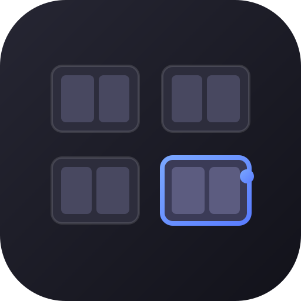
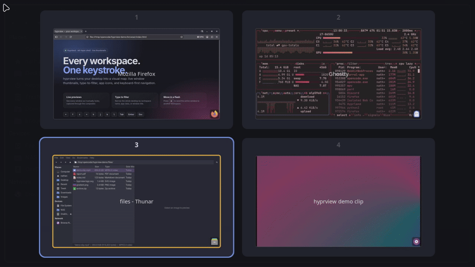

<p align="center">
  
</p>

<h1 align="center">hyprview</h1>

<p align="center">
  <strong>A fast, keyboard-driven workspace overview for Hyprland.</strong><br>
  Live window thumbnails, type-to-filter, and app icons — no compositor plugin required.
</p>

<p align="center">
  <a href="https://github.com/nnthnn/hyprview/actions/workflows/ci.yml"></a>
  <a href="https://nnthnn.github.io/hyprview/"></a>
  <a href="LICENSE"></a>
  
</p>

<p align="center">
  
</p>

hyprview runs as a small background daemon. On demand it puts up a fullscreen
overlay showing every workspace with real window thumbnails, then lets you
navigate, filter, focus, and move windows — all from the keyboard or, if you
opt in, the mouse.

## Features

- **Live window thumbnails** via `hyprland-toplevel-export-v1` (Hyprland only)
- **Workspace grid** with named/numbered labels and real window layout per card
- **Keyboard-first navigation** with arrows or `hjkl`, plus `1`–`9` for direct card jumps
- **Tab / Shift+Tab window cycling** across all workspaces, starting from the focused window
- **Type-to-filter** across workspace names, window classes, and titles, with non-matches dimmed
- **Enter to act** on the Tab-highlighted window, the single filter match, or the selected workspace
- **Move windows** with `m` — send the active window to the selected workspace
- **Close windows** with `Delete`, targeting the hovered window or single filter match
- **App icons** on thumbnails, resolved from the icon theme and `.desktop` files
- **Hover tooltip** with the app icon, name, class, and window title
- **Optional mouse support** — hover to select, left-click to focus/switch, right-click to move
- **Config hot reload** when the config file changes (or on `SIGHUP`)
- **Daemon lifetime** with a single-instance lock and near-zero CPU while hidden
- **No process spawning** — workspace/window operations go straight over the compositor's IPC socket

## Requirements

- Linux with a Wayland compositor that supports `wlr-layer-shell`
- **Hyprland 0.55+** for the full feature set, including live thumbnails
- **Sway** works with reduced functionality: there are no live thumbnails, so
  windows are drawn as coloured placeholders with their app id (the same
  fallback as `--no-preview`)
- No GTK, Qt, or other toolkit at runtime

## Install

The AUR package isn't published yet, so for now build from source. The tracked
packaging source is in
[`packaging/aur/hyprview-git`](packaging/aur/hyprview-git).

### Arch Linux

Using the tracked `hyprview-git` package:

```
git clone https://github.com/nnthnn/hyprview.git
cd hyprview/packaging/aur/hyprview-git
makepkg -si
```

### From source

Build dependencies: a Rust toolchain, `pkg-config`, and the Wayland, Cairo, and
Pango development headers.

```
# Arch
sudo pacman -S --needed base-devel rust wayland pango

# Debian / Ubuntu
sudo apt install cargo pkg-config libwayland-dev libpango1.0-dev
```

Then:

```
git clone https://github.com/nnthnn/hyprview.git
cd hyprview
cargo build --release
```

The binary is at `target/release/hyprview`.

Install it system-wide:

```
sudo install -Dm755 target/release/hyprview /usr/local/bin/hyprview
```

Or user-local (make sure `~/.local/bin` is on your `PATH`):

```
install -Dm755 target/release/hyprview ~/.local/bin/hyprview
```

## Usage

Start the daemon in the background:

```
hyprview &
```

Toggle the overlay from anywhere:

```
hyprview --toggle
# equivalent:
pkill -SIGUSR1 hyprview
```

Force a config reload:

```
pkill -SIGHUP hyprview
```

`hyprview --toggle` uses a PID lock file in `$XDG_RUNTIME_DIR`, so it can find
the running daemon without a process lookup. Starting a second `hyprview`
instance is a no-op — the existing instance keeps running.

### Hyprland config

Hyprland 0.55+ reads `~/.config/hypr/hyprland.lua`. If you have migrated to the
Lua config, add the daemon to your startup and bind a key to the toggle:

```lua
-- ~/.config/hypr/hyprland.lua
hl.on("hyprland.start", function()
    hl.exec_cmd("hyprview")
end)

hl.bind("SUPER + Tab", hl.dsp.exec_cmd("hyprview --toggle"))
```

Replace `SUPER` with your `mainMod` if you use a different modifier. If
`hyprview` is installed somewhere Hyprland does not see on `PATH` (for example
`~/.local/bin`), use the full path in `hl.exec_cmd`. Hyprland loads
`hyprland.lua` in preference to a legacy `hyprland.conf`, so the old
`exec-once`/`bind` syntax will not take effect while a Lua config exists.

### Sway config

Sway is auto-detected via `SWAYSOCK`/`I3SOCK` and runs in fallback mode without
live thumbnails:

```
# ~/.config/sway/config
exec hyprview
bindsym $mod+Tab exec hyprview --toggle
```

### Flags

| Flag | Description |
| --- | --- |
| `--toggle` | Send `SIGUSR1` to the running daemon and exit |
| `--no-preview` | Skip thumbnails and draw coloured placeholder rectangles |
| `--allow-mouse` | Enable mouse hover, click, and right-click support |

Flags can be combined, for example:

```
hyprview --no-preview --allow-mouse &
```

## Controls

| Input | Action |
| --- | --- |
| Arrow keys / `hjkl` | Navigate the workspace grid |
| Tab / Shift+Tab | Cycle the window highlight across all workspaces (starts from the focused window) |
| Enter | Focus the highlighted window, the single filter match, or switch to the selected workspace |
| `1`–`9` | Jump to the 1st–9th workspace card in the grid |
| Type | Filter workspaces, window classes, and titles |
| Backspace | Delete the last filter character |
| `m` | Move the active window to the selected workspace (when not filtering) |
| Delete | Close the hovered window, or the single filter match |
| Escape | Clear the Tab highlight, then the filter, then close the overlay |
| Mouse (with `--allow-mouse`) | Hover to select and show the tooltip; left-click a window to focus it, a card to switch workspace, or outside to close; right-click to move the active window to the selected workspace |

`hjkl` navigation is disabled while a filter is active; the arrow keys always
work. Number keys only jump when the filter is empty.

## Configuration

hyprview reads `$XDG_CONFIG_HOME/hyprview/config.toml`, falling back to
`~/.config/hyprview/config.toml`. Every key is optional. On first run the file
is seeded from the bundled [`config.example.toml`](config.example.toml); an
existing pre-rename `~/.config/hyprexpose/config.toml` is migrated automatically.

The file is watched for changes and reloaded live. You can also send `SIGHUP`
to force a reload. Unknown sections and keys are reported on stderr so typos
don't silently fall back to defaults.

See [`docs/configuration.md`](docs/configuration.md) for the full reference, or
[`config.example.toml`](config.example.toml) for the annotated file.

## Contributing

Bug reports and pull requests are welcome. See
[`CONTRIBUTING.md`](CONTRIBUTING.md) for the short version, and
[`docs/development.md`](docs/development.md) for architecture notes, build and
test commands, packaging, and the release process. Release history is in
[`CHANGELOG.md`](CHANGELOG.md).

## License

MIT — see [`LICENSE`](LICENSE).

hyprview began as a fork of
[hyprexpose](https://github.com/ThiagoAVicente/hyprexpose) by ThiagoAVicente.
It has since diverged into its own project, adding type-to-filter, Tab cycling,
app icons and tooltips, window closing, config hot reload, packaged releases,
and this documentation and site.
